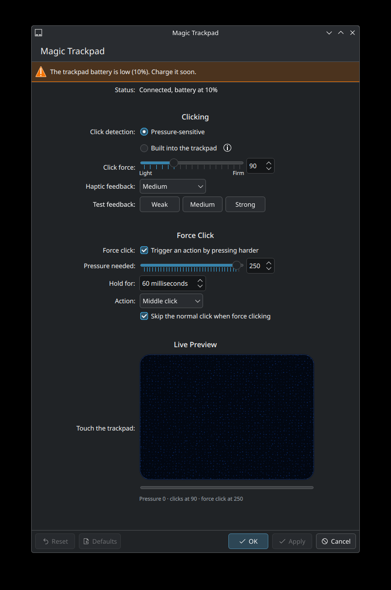
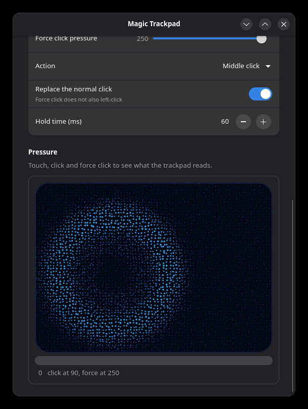

# mt2d — Magic Trackpad 2 for Linux

Pressure-sensitive clicking, adjustable click force, haptic feedback strength,
silent clicks and **force click** for the Apple Magic Trackpad 2 on Linux,
with a native settings page for KDE Plasma and a GTK app for everything else.

Free and open source. Runs in userspace next to the in-kernel
`hid-magicmouse` driver: no kernel module, survives kernel updates.

<p align="center">
  
  
</p>

## Features

- **Click force** — choose how hard you have to press to click
- **Haptic feedback** — light, medium, firm, maximum, or off (silent clicks)
- **Force click** — press harder after clicking to trigger an action: middle
  click, right click, back, forward, Overview, or any key combination
- **Live preview** — a GPU-rendered view of the trackpad: fingers light up the
  dots under them, clicks and force clicks send ripples through it
- **Battery level** and a low-battery warning
- **On-demand haptics** — `mt2d pulse strong`, usable from scripts
- Everything else (gestures, two-finger right click, tap to click, palm
  rejection, pointer speed) stays with libinput and your desktop's own
  touchpad settings, exactly as before

Tested with the Lightning Magic Trackpad 2 over Bluetooth and USB. The USB-C
model is recognised but untested; reports welcome.

## How it works

The trackpad has no mechanical button. Its firmware decides when to "click"
and fires the haptic motor. mt2d switches it into **host-click mode**, in
which the firmware stops clicking and reports real force values instead of a
pressure byte that saturates as soon as you click. mt2d then:

1. grabs the kernel's evdev node and re-emits it through an identical uinput
   device (same name, IDs and properties, so libinput quirks and your desktop
   settings still apply),
2. turns the force curve into left clicks and force clicks, injected into that
   stream,
3. fires the haptic motor itself through hidraw.

When mt2d stops (or crashes — systemd runs `mt2d restore`), the trackpad goes
back to clicking on its own.

| Report | Purpose |
|---|---|
| feature `21 01/00` | host-click mode on/off |
| feature `22 …` / `23 …` | stored click / release feel (`0xCCBBSS`) |
| output `53 …` | fire the actuator once |

Over Bluetooth these go to the single HID interface, wrapped in report `F2`,
and the actuator report must be sent as a SET_REPORT. Over USB the trackpad
splits into four interfaces: touches arrive on interface 1, the battery on
interface 0, and the reports above go unwrapped to interface 2 (the one
declaring output report `0x53`), with the actuator report as a plain
interrupt write.

The live preview is a two-pass fragment shader: pass 1 computes each dot's
light and displacement once into a tiny texture, pass 2 shades pixels from
their 3×3 nearest dots. It only renders while something moves. Worst case
(8 force-click ripples + 5 fingers) on an Intel UHD 770:

| Field size | Single pass | Two passes |
|---|---|---|
| 440×306 @1× | 1.47 ms | 0.28 ms |
| 440×306 @2× (HiDPI) | 5.79 ms | 1.07 ms |
| 720×500 @2× | 15.44 ms | 2.83 ms |

## Install

Requirements: Python 3.11+, `python-evdev`, a user in the `input` group
(for evdev and uinput access). Settings: `kcmutils`, `qt6-shadertools`
and `extra-cmake-modules` to build the KDE page; `python-gobject`,
`libadwaita` and `python-opengl` for the GTK app.

```sh
git clone https://github.com/JeyKul/magic-trackpad-linux
cd magic-trackpad-linux
./install.sh
```

The installer puts `mt2d` and `mt2d-settings` in `~/.local/bin`, enables the
`mt2d` user service, installs a udev rule that gives the logged-in user access
to the trackpad's hidraw node (asks for sudo once), and on Plasma builds and
installs the System Settings page (sudo again).

**Arch Linux:** `cd packaging/arch && makepkg -si`, then
`systemctl --user enable --now mt2d`.

Settings live in **System Settings → Mouse & Touchpad → Magic Trackpad** on
Plasma, or the **Magic Trackpad** app elsewhere. Everything is also in
`~/.config/mt2d/config.toml` (see `config.example.toml`); apply edits with
`mt2d reload`.

## Command line

```
mt2d status            trackpad, battery and current config
mt2d pulse [strength]  fire the actuator (weak, medium, strong, max, or 0xCCBBSS)
mt2d monitor           live pressure meter
mt2d reload            re-read the config file
mt2d restore           give clicking back to the firmware
```

## Credits

The haptic and host-click protocol was worked out by others first:

- [MagicTrackpad2ForWindows](https://github.com/vitoplantamura/MagicTrackpad2ForWindows)
  by Vito Plantamura and contributors — the Windows driver that inspired this,
  including its haptic presets
- [dos1's Linux Magic Trackpad 2 driver](https://github.com/dos1/Linux-Magic-Trackpad-2-Driver)
  — the original haptic feature reports
- [LinuxMagicForce](https://github.com/Eriskii/LinuxMagicForce) by Eriskii —
  host-click mode and the one-shot actuator report

No code was copied from them; mt2d is an independent implementation.

Apple, Magic Trackpad and Force Touch are trademarks of Apple Inc. This
project is not affiliated with Apple.

## License

MIT
